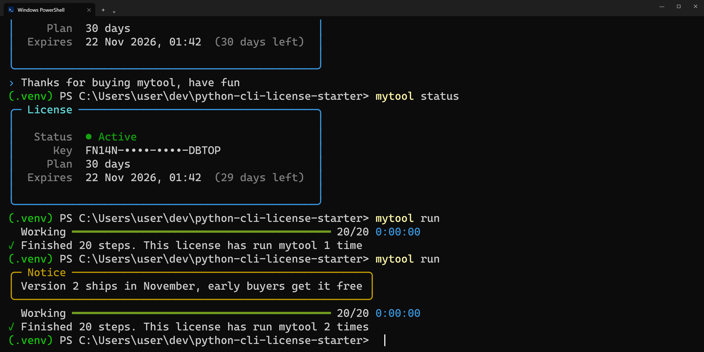
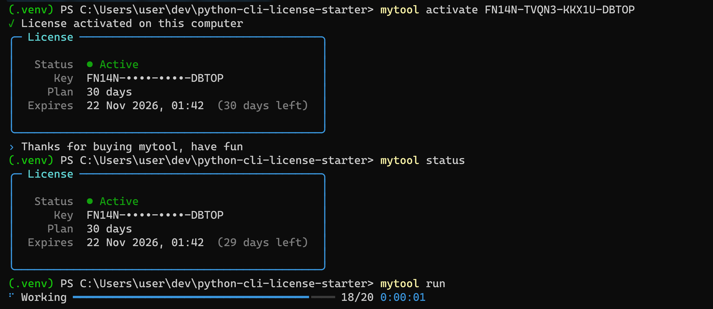
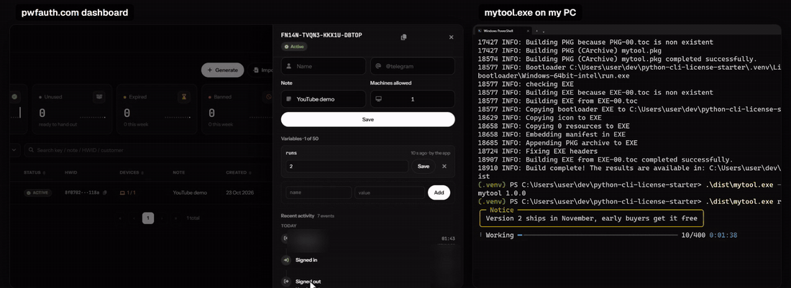
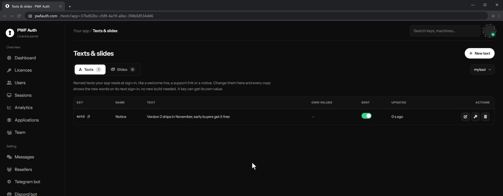

<p align="center">
  <b>English</b> · <a href="README.zh-CN.md">简体中文</a> · <a href="README.tr.md">Türkçe</a> · <a href="README.ar.md">العربية</a>
</p>

# python-cli-license-starter

A small template for selling a Python command-line tool with license keys. Clone it, rename `mytool`, and put your own commands in `commands.py`

[](https://www.python.org/)
[](LICENSE)

<p align="center">
  
</p>

The licensing runs on [PWF Auth](https://pwfauth.com), which is free. You'll need an account there for the app secret and the keys

There's a 3 minute video of the whole thing, recorded for real, from `git clone` to banning a key while the exe runs: [youtu.be/2tYxlYZwNnc](https://youtu.be/2tYxlYZwNnc)

## Try it

```bash
git clone https://github.com/pwfauth/python-cli-license-starter.git
cd python-cli-license-starter
python -m venv .venv
source .venv/bin/activate              # Windows: .venv\Scripts\activate
pip install -e ".[dev]"
export PWFAUTH_SECRET=your-app-secret  # PowerShell: $env:PWFAUTH_SECRET = "your-app-secret"
mytool activate YOUR-LICENSE-KEY
mytool run
```

The secret is on your app's card under Applications in the panel. Keys are made under Licences

<p align="center">
  
</p>

## What's in it

- `mytool activate` binds a key to this machine and keeps it in the OS credential store (Credential Manager on Windows, Keychain on macOS, Secret Service on Linux)
- `mytool trial` gives out the free trial, once per machine
- `mytool status` shows the license without taking a device seat. Add `--json` when a script needs it
- `mytool update` tells people when you publish a new version, with the changelog
- `mytool deactivate` forgets the key on this machine
- `mytool run` is the paid part. Replace it with your own work

When a key is already in use on another computer, `activate` offers to move it here. Whether customers can do that, and how often, is a setting in the panel

## Revoking a key while it runs

<p align="center">
  
</p>

Paid commands run inside `get_licensing().session()`. While the block runs, a heartbeat checks the key in the background. Ban, pause or delete the key in the panel and the command stops on the next heartbeat with exit code 3

How it stops: the heartbeat thread calls `_thread.interrupt_main()` and the session turns that `KeyboardInterrupt` into `SessionEnded`. Code stuck in a C call can't be interrupted, so after 10 seconds the process exits anyway

## Adding your own command

```python
from .cli import app, friendly, get_licensing

@app.command()
@friendly
def convert(path: str) -> None:
    """Convert a folder (paid)"""
    with get_licensing().session() as session:
        for item in load(path):
            process(item)
            session.ensure_active()   # optional, stops between items once the key is revoked
```

`licensing.py` is the only file that talks to the license server, so the rest of the code doesn't care where the keys come from

## Status and updates

<p align="center">
  
</p>

Publish a version under Updates in the panel and `mytool update` shows it. Texts under Texts & slides show up in the tool too: the example prints a text called `motd` at the start of every run, so you can tell people something without shipping a new build

## Shipping a binary

```bash
pip install -e ".[build]"
PWFAUTH_SECRET=your-app-secret python scripts/build.py
```

That gives you `dist/mytool.exe` on Windows, `dist/mytool` elsewhere. The secret is baked in for that build only. `build/`, `dist/` and `src/mytool/_build_secret.py` all contain it, which is why they're in `.gitignore`

Anything you ship to a customer's machine can be patched. The server signs every reply, so a fake server can't unlock the tool, but if something is really valuable, keep it on your own server and check the license there

## Settings

| Variable | What it's for |
|---|---|
| `PWFAUTH_SECRET` | Your app secret (a release build has it baked in) |
| `MYTOOL_LICENSE_KEY` | A key for CI or a server, used for that run and never saved |
| `MYTOOL_STORE` | `keyring` (default) or `file` |
| `MYTOOL_HOME` | Where the file store keeps the key |

Machines without a credential store, like a headless server or a container, fall back to a file only the current user can read

Exit codes: `0` fine, `1` setup or network problem, `2` no license or the server said no, `3` the license ended mid-run, `130` Ctrl+C

## Tests

```bash
pytest
```

They run against a fake client in `tests/conftest.py`, no network or account needed

## License

MIT, see [LICENSE](LICENSE)
