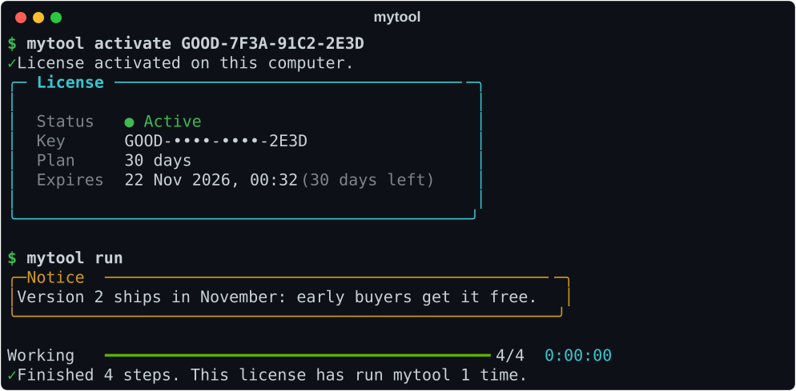
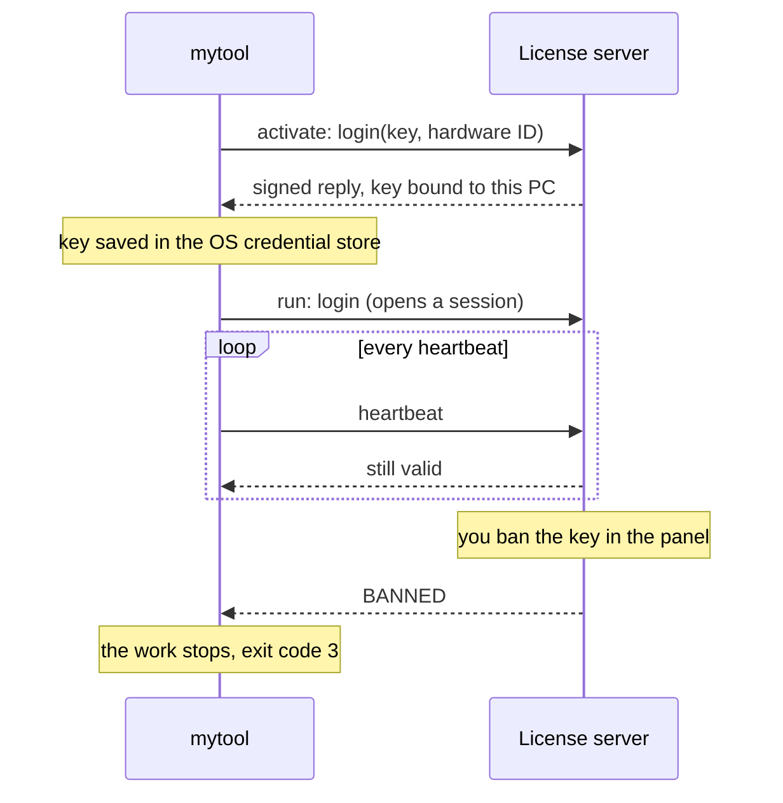
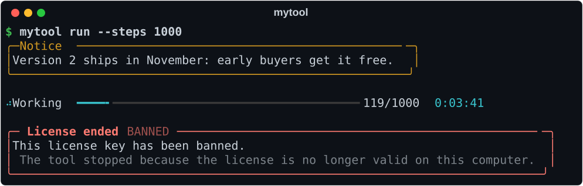
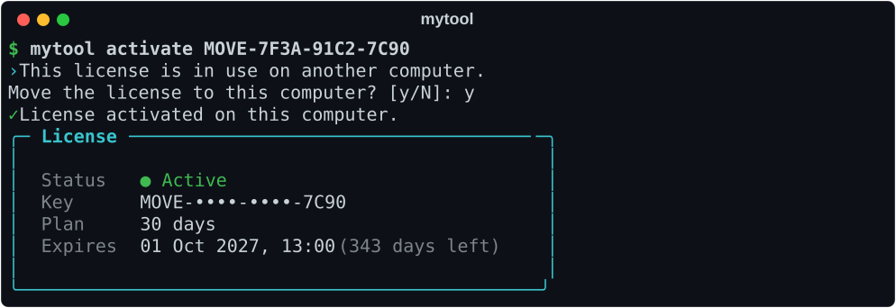
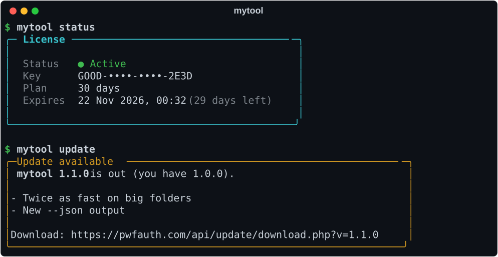

# Python CLI License Starter

A starter template for selling a Python command-line tool with license keys. You get activation,
a free trial, moving a license to a new computer, update checks, and a kill switch that stops a
running job when you revoke its key. Rename it and put your own commands in.

[](https://www.python.org/)
[](LICENSE)
[](https://typer.tiangolo.com/)
[](https://pwfauth.com)

<p align="center">
  
</p>

## Features

- **License keys:** `mytool activate KEY` binds the key to this computer (hardware ID) and saves it in the OS credential store.
- **Free trial:** `mytool trial` gets a trial key for this computer, once per machine.
- **Kill switch:** paid work runs inside a live session. Ban, pause or delete the key and the job stops within one heartbeat, with exit code `3`.
- **Move to a new PC:** if a key is in use on another computer, the user can move it here themselves. You set the cooldown.
- **Status without a seat:** `mytool status` (and `--json` for scripts) reads the license without opening a session.
- **Remote texts:** show a message in the tool without shipping a new version.
- **User variables:** keep small per-customer values on the server. The example counts runs.
- **Update check:** `mytool update` shows the newest version, its changelog and a download link.
- **Single-file builds:** `scripts/build.py` makes one executable with PyInstaller.
- **Tested offline:** 27 pytest tests run against a fake client in about two seconds.

## Quick start

You need Python 3.9 or newer and an app secret. Get one with a free account at
[pwfauth.com](https://pwfauth.com): open **Applications**, create an app and copy its secret.
Then make a key under **Licences**.

```bash
git clone https://github.com/pwfauth/python-cli-license-starter.git
cd python-cli-license-starter
python -m venv .venv
source .venv/bin/activate                 # Windows: .venv\Scripts\activate
pip install -e ".[dev]"
export PWFAUTH_SECRET=<your app secret>   # Windows: set PWFAUTH_SECRET=<your app secret>
mytool activate <your key>
mytool run
```

## Commands

| Command | What it does |
|---|---|
| `mytool activate [KEY] [--yes]` | Binds a key to this computer and saves it. Offers to move a key that is in use elsewhere. |
| `mytool trial [--yes]` | Starts this computer's free trial. Turn trials on in the app's settings. |
| `mytool status [--json]` | Shows the license: status, plan, expiry and days left. Uses no device seat. |
| `mytool deactivate [--yes]` | Removes the saved key from this computer. |
| `mytool update [--channel stable]` | Checks for a newer version. |
| `mytool run [--steps N]` | The example paid command. Replace it with your tool's work. |

**Exit codes:** `0` OK, `1` setup or network problem, `2` no license or the server refused it,
`3` the license ended while the tool was working, `130` cancelled with Ctrl+C.

## Make it yours

1. Rename `mytool` in three places: the `name` and `[project.scripts]` entries in
   `pyproject.toml`, the `src/mytool` folder, and `APP_NAME` in `src/mytool/config.py`.
2. Put your commands in `src/mytool/commands.py`, and wrap paid work in a session:

```python
from .cli import app, friendly, get_licensing

@app.command()
@friendly
def convert(path: str) -> None:
    """Your paid command."""
    with get_licensing().session() as session:
        for item in load(path):
            process(item)               # your work
            session.ensure_active()     # optional: stop between items once the license ends
```

3. Keep `licensing.py` as it is. It is the only file that talks to the license server.

## How it works



### The kill switch

<p align="center">
  
</p>

The heartbeat runs on a background thread. When the server ends the session, `Licensing.session()`
interrupts the main thread, which turns into a `SessionEnded` error and a clean exit with code `3`.
Work stuck inside C code gets 10 seconds to stop, and then the process exits anyway.
`session.ensure_active()` is there for loops that want to check between steps.

### Moving to a new computer

<p align="center">
  
</p>

The move frees the key from every machine it was bound to and ends their sessions. In the app's
settings you decide whether customers may do this themselves and how long they wait between moves
(12 hours by default).

### Status and updates

<p align="center">
  
</p>

Publish a version under **Updates** and `mytool update` shows it with its changelog.
Remote texts live under **Texts & slides**: the example shows a text named `motd` at the start of
every run.

## Configuration

| Variable | Purpose |
|---|---|
| `PWFAUTH_SECRET` | Your app secret. A release build embeds it instead (see below). |
| `MYTOOL_LICENSE_KEY` | A key for CI and servers. It is used for that run and never saved. |
| `MYTOOL_STORE` | `keyring` (default) or `file`. |
| `MYTOOL_HOME` | The settings folder, used by the file store. |

The key is stored in Windows Credential Manager, the macOS Keychain or the Linux Secret Service.
Machines without one, such as a headless server or a container, fall back to a file that only the
current user can read.

## Build a single executable

```bash
pip install -e ".[build]"
PWFAUTH_SECRET=<your app secret> python scripts/build.py
```

The result is `dist/mytool` (`dist\mytool.exe` on Windows). The script writes the secret into
`src/mytool/_build_secret.py` for the build and deletes it afterwards. That file, `build/` and
`dist/` all contain the secret, and all three are in `.gitignore`.

## Tests

```bash
pytest
```

The tests use a fake client (`tests/conftest.py`), so they need no network and no account.

## Security notes

- The app secret identifies your app. It ends up inside your shipped binary, as it does with every
  client-side licensing system. It is not a password, so never reuse it as one, and keep it out of
  public repositories.
- Every reply is checked against the server's pinned signing key. A fake server or a proxy that
  answers "success" does not unlock the tool.
- A user who controls their own machine can always patch a Python program. Keep anything of real
  value on your server, behind the license check.

## Powered by PWF Auth

The licensing in this template runs on [PWF Auth](https://pwfauth.com), a free licensing and
authentication service for desktop software. It provides the license keys, hardware binding,
sessions with a kill switch, trials, remote texts, user variables and update checks used here,
through the official [`pwfauth`](https://pypi.org/project/pwfauth/) package. The dashboard is where
you create keys, ban them, publish updates and edit the texts.

Using a different backend? `src/mytool/licensing.py` is the only file that talks to the server.
Rewrite it and the commands keep working.

## Project layout

```
src/mytool/
  cli.py         license commands: activate, trial, status, deactivate, update
  commands.py    your tool's commands (the example: run)
  licensing.py   the license layer, the only file that talks to the server
  store.py       where the key is kept (OS credential store, or a file)
  config.py      app name, app secret, settings folder
  ui.py          the license card, notices and errors
scripts/build.py PyInstaller build with the secret embedded
tests/           pytest suite with a fake client
```

## License

[MIT](LICENSE) © 2026 PWF Studio
